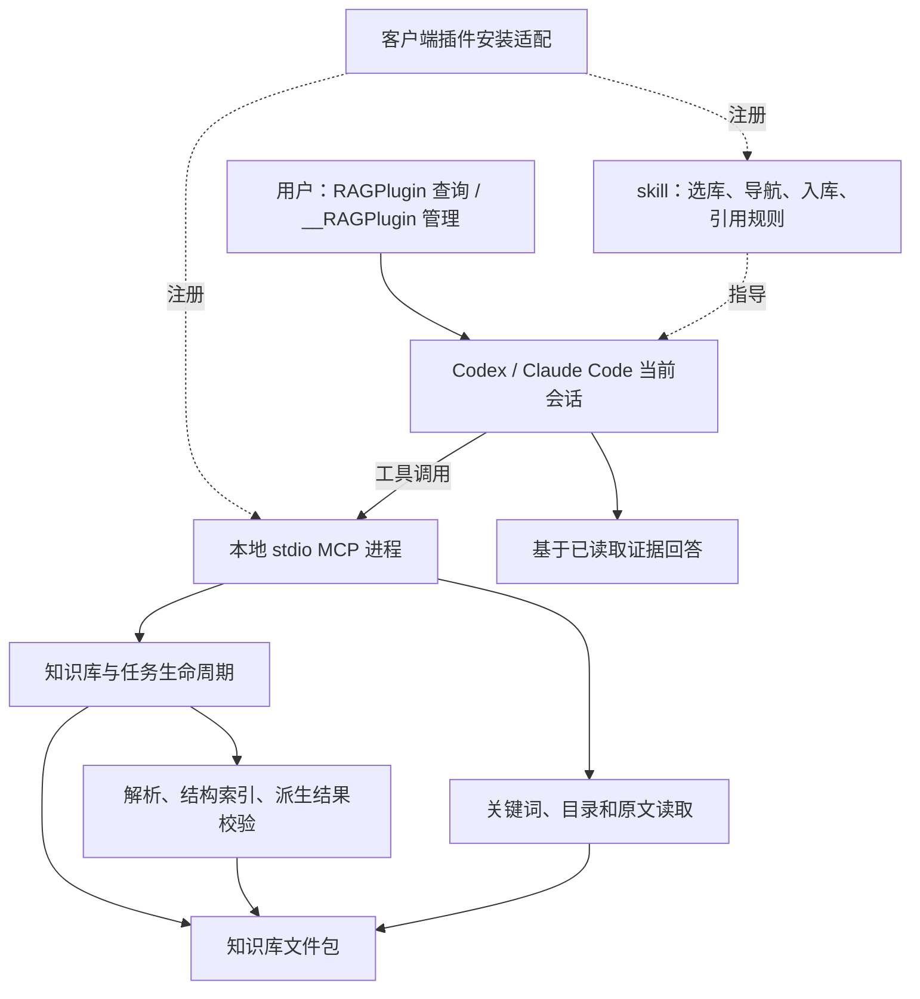

# RAGPlugin 插件式知识库技术方案（V2）

更新日期：2026-11-13

状态：V2 文件版实现已落地；本文保留设计契约，实际完成与验收状态见第 9、10 节及 docs/progress.md。用户本轮指定先验收 Codex，Claude Code 保留适配、真实宿主验收待开展。

依据：用户确认的新解法；原《RAG 工程师实践题.txt》只作历史背景，不再要求逐项满足。

> 本次用户已明确授权实施新版。代码已切换为 Skill + 本地 stdio MCP + 文件知识库，初版 Web/HTTP/PG/向量/图谱/内部模型执行链路及专属依赖已移除；用户数据、凭据、已有服务未做迁移或清理。[README.md](README.md) 和 [使用说明书.md](使用说明书.md) 已同步 V2 加载与使用流程。协议测试、Codex 实测、Claude 待验收须分别阅读 [docs/progress.md](docs/progress.md)，不能互相替代。

## 1. 目标与范围

RAGPlugin 是供本地 Codex、Claude Code 使用的知识库插件。用户以“用 RAGPlugin……”查询，以“用 __RAGPlugin……”执行指定的建库、挂载、导入、更新、删除或卸载操作。知识库是可搬迁的文件目录；检索采用章节树导航、全文关键词定位和按需原文读取，由当前宿主会话负责推理与带引用回答。

### 1.1 必须完成

- 不提供独立前端；所有用户操作在 Codex／Claude Code 中完成。
- 同一业务核心、Skill 主体与 MCP 工具，分别提供两个客户端的安装适配和真实接入验证。
- 一库一目录，无需数据库服务、向量服务器或额外生成模型 API Key。
- 支持 UTF-8 Markdown、文本型 PDF、DOCX；保留原文件、正文、结构、图片和来源位置。
- 图片信息进入检索链路，由当前会话读取真实图片、生成描述，明确标为派生证据。
- 借鉴 PageIndex 的结构导航思路，自行实现所需最小能力，不包装现成 RAG 产品。
- 支持增量更新、失败恢复、只读挂载、多客户端读取与串行写入；严格限定知识库范围。
- 验证引用、跨文档证据、无答案、修改失效、搬迁以及双客户端完整流程。

### 1.2 首版边界

面向本地单用户、少量至数百份资料的交互式流程；规模只是评测起点，不是性能承诺。同一用户可在 Codex 与 Claude Code 同时挂载同一知识库。网页版 Claude、远程托管 Agent、网络共享盘并发写入不纳入首版兼容承诺。

首版不做独立 Web、通用 REST 服务、PostgreSQL、向量召回、持久知识图谱、三路融合、独立回答模型、无人值守批量模型入库、OCR、复杂版式精确还原、多租户权限、分布式队列、插件市场托管或 ZIP 包自动导入。

不使用 LangChain/LangGraph，不预建多 Agent 编排、向量适配层或通用插件框架。若评测证实语义召回缺口，再单独设计扩展；不能因“以后可能需要”保留旧整套运行链路。

## 2. 架构与模块



### 2.1 职责划分

| 层 | 职责 | 边界 |
| --- | --- | --- |
| 插件安装适配 | 分发版本，注册 MCP/Skill，客户端诊断 | 共用核心，不携带用户资料 |
| Skill + 当前会话 | 理解意图、选库、选择章节、图片理解、可选摘要、回答 | 提示词不承担路径、权限或数据完整性校验 |
| MCP + 业务函数 | 管理文件、解析、检索、读取证据、校验与发布 | 不启动内部模型 CLI、不调用外部模型 API、不生成最终答案 |

MCP 使用本地 stdio，由客户端按配置启动，不要求用户先启动 HTTP 服务或 Docker。stdout 专供协议，日志写 stderr。关闭客户端后不承诺继续模型任务；恢复依据持久检查点。

插件展示名称为 RAGPlugin，技能名为 `ragplugin`。两个客户端共用 Skill 主体，但分别验证安装清单和显式入口，不承诺插件格式完全一致。调用标记为 `RAGPlugin`（只读）与 `__RAGPlugin`（可执行本次指定管理操作），由同一 Skill 区分，不安装两套插件。安装指南须同时给出实际验证过的显式技能入口；显式入口本身不授予写权限，管理请求仍须带 `__RAGPlugin`。

### 2.2 技术选择

复用 Python、官方 MCP Python SDK、Pydantic、PyMuPDF、python-docx 与已有中文分词能力。权威数据采用 UTF-8 Markdown/JSON。锁、哈希和原子替换集中到存储模块。Markdown 解析须处理代码围栏、标题层级与重复标题，优先采用合适的成熟解析能力，不将简单逐行正则当作完整解析器。

首版全文检索遍历已发布正文与图片派生文本，按统一分词、词频与标题命中排序，另提供精确字符串匹配。缓存可删除重建；没有词面重叠时不保证语义召回。只有测得瓶颈后才考虑 SQLite/FTS，并验证中文效果，不预先新增数据库依赖。

### 2.3 已实现模块边界

| 模块 | V2 职责 |
| --- | --- |
| `app/main.py`、`app/mcp.py` | stdio 入口、生命周期、工具参数与结果转换 |
| `app/config.py`、`app/schemas.py` | 本机配置、版本化文件格式及工具 Schema |
| `app/knowledge.py` | 建库、挂载、清单、卸载与逻辑删除 |
| `app/storage.py` | 路径、哈希、跨进程锁、原子 manifest、版本读取 |
| `app/ingestion.py` | 交互式入库、幂等、恢复、派生结果校验和发布 |
| `app/parsers/` | Markdown/PDF/DOCX 解析，原文位置与图片 |
| `app/indexing.py` | 章节树、长节点分页、来源映射 |
| `app/retrieval/` | 候选定位、目录与原文读取、证据版本校验 |
| `skills/ragplugin/SKILL.md` | 共用宿主工作流，替换现有 knowledge-base Skill |
| `scripts/`、`tests/` | 安装诊断、评测、逻辑与真实文件/进程/MCP 测试 |

模块名是目标分工，不要求提前创建空目录或抽象。MCP 与维护脚本复用普通业务函数；不再要求存在第二套 HTTP 入口。`CLAUDE.md` 继续引用 `AGENTS.md`。

## 3. 知识库文件结构

### 3.1 一库一目录与版本发布

为避免读取半份索引，已发布文档使用不可变 revision 目录，由单一 manifest 指向当前版本：

```text
项目资料/
├── manifest.json
├── documents/
│   └── <doc_id>/
│       └── <doc_revision>/
│           ├── source.md | source.pdf | source.docx
│           ├── content.md
│           ├── tree.json
│           ├── locations.json
│           ├── derived.json
│           └── assets/
├── .work/
│   └── <task_id>/           # 未发布产物、检查点与任务记录
├── .index/                 # 可重建缓存，允许不存在
└── .write.lock             # 操作系统锁的固定载体
```

每个版本仅有一种 source 文件。原生 Markdown 可直接以 source.md 为正文，不强制复制 content.md；PDF/DOCX 生成 content.md。derived.json 保存图片描述与可选摘要；无派生内容或图片时可省略对应文件/目录。

.work 不参与检索，.index 不是事实来源。更新生成新版本，不逐文件覆盖正在读取的版本；旧版本只服务恢复和安全清理，不扩展成版本管理产品。复制/迁移须在停止写入后进行，不能复制一半发布中的包。

### 3.2 数据契约

| 对象 | 最小字段与语义 |
| --- | --- |
| manifest | format_version、kb_id、name、description、单调递增 kb_revision、documents、删除/待清理记录、幂等操作回执 |
| documents 条目 | doc_id、name、media_type、doc_revision、版本相对路径、source_sha256、产物哈希、index_version、coverage；只列已发布版本 |
| tree 节点 | node_id、parent_id、title、order、直属正文区间、子节点 ID、可空摘要引用、structure_quality |
| locations | 正文区间对应原始位置：PDF 页码/bbox，DOCX part/段落/表格行列，MD 行号/标题路径；图片的出现位置 |
| derived 条目 | 类型、节点/图片 ID、源哈希、派生文本、处理状态、可获得的提供方/模型信息、生成时间与流程版本 |
| task | task_id、operation_id、kb_id、doc_id、attempt、源哈希、预期旧文档版本、状态、检查点、错误与待处理图片 |

首版包格式 format_version=1，与产品 V2 是不同概念。不支持的格式版本直接拒绝。模型信息不可得时标未知，不猜填。所有 JSON 进行 Schema、大小、条目数、归属、哈希和路径校验。

行号统一 1-based；字符区间为 Unicode 码点偏移、左闭右开，不混用字节或 UTF-16 偏移。索引绑定正文哈希；node_id 只在同一 doc_revision 内稳定。引用不能仅靠标题或裸节点 ID。

### 3.3 挂载、搬迁与编辑

- 包内全部采用相对路径，不保存盘符、登录信息、客户端会话或全局配置。
- 本机挂载注册表单独放在插件运行数据目录，记录 kb_id 对应根目录与只读/读写模式；不放入知识库或插件安装目录。注册表也使用跨进程锁与原子替换。
- 挂载本身改变本机注册表，必须使用 `__RAGPlugin`；默认只读挂载。在带管理标记的明确导入/更新请求中可取得读写挂载，不对本次工作流的每次写入重复确认。只读挂载不写包，无缓存时直接读发布产物；已有读写挂载不使普通 `RAGPlugin` 请求获得写权限。
- 卸载只取消注册，不删文件；移动目录后重新挂载。挂载不自动执行包内内容或重建索引。
- 同一 kb_id 已在另一路径挂载时拒绝重复副本，需显式替换挂载或另建库；不自动合并。
- 用户维护的外部 Markdown 源文件经更新工具提交。手工改动包内已发布源文件/产物会触发哈希失效，受影响文档停止召回并提示重建。
- PDF/DOCX 转换正文属于派生文件；不能将手工修改当成原文。更正时更新源文件，或另建独立 Markdown 来源。
- 包离线、移动、缺文件均返回明确错误。只读查询可以使用完整的已发布包，不要求本机拥有原始导入路径。

### 3.4 文件访问边界

除建库、挂载、列库入口外，所有工具必须限定 kb_id，校验 doc/node/task/asset 归属。只有 create/mount/import 接受明确的入口路径，路径限制在本机配置或用户明确授权的目录范围；证据和图片读取不接受任意路径。

包内拒绝绝对路径、路径穿越和符号链接/reparse point 逃逸，最终打开位置必须在受控根目录。文件包不能携带可执行 Skill、MCP 配置或钩子。首版不承诺抵御不受信任进程恶意并发改写，但检测到哈希变化必须停止使用旧索引。资料中的命令不能改变工具权限。

## 4. 导入、宿主协作与一致性

### 4.1 交互式导入

```text
import_document
→ 校验并复制源文件到 .work
→ 确定性解析、检查点、标题/页/段落树
→ 有图片则等待当前会话读取真实图像并提交描述
→ 可选章节摘要
→ 校验来源、覆盖与产物哈希
→ publish_document 原子发布
```

MD 按语法标题构树；DOCX 优先标题样式；PDF 优先书签、目录及可验证版式。当前 PDF 字号启发式不能视为可靠多级目录。结构不足则用页/段落节点并标 structure_quality，不伪造标题或页码。长章节保留层级并分页读取，不按旧 Embedding token 限制机械分块。

任务状态：queued → parsing → awaiting_enrichment（如需）→ ready_to_publish → published；处理中可进入 failed/cancelled。任务与已发布文档分开：更新失败保留完整旧版，查询明确返回旧版本并提示更新待完成；新文档发布前不可召回。

基础索引不强制模型摘要。摘要只辅助导航；图片描述是图片入库必需阶段。当前会话必须取得实际图片与邻近正文，返回可见文字、说明及不确定项；仅给模型路径不算读图。技术失败/未处理阻止完整发布；不可辨认、装饰性等结果须显式记录 coverage，不能声称所有内容都已识别。缺少宿主视觉能力时停在等待阶段，不能偷偷降为全文完整可检索。

MCP 校验 task/attempt/源哈希与节点、图片归属，限制输出长度；逐字摘录需匹配原文。结构校验不等于语义正确，图像理解需真实宿主与抽样人工核对。

模型工作全部由当前会话完成，不在 MCP 内嵌模型 CLI，不隐式回调模型、不假定 MCP sampling 可用，不读取登录凭据或切换提供方。模型用量来自宿主额度；文件本地保存不代表宿主模型处理完全离线。

### 4.2 幂等、恢复与发布

- 多进程可读取同一库，状态变更统一走每库跨进程写锁。使用操作系统锁释放语义，不以锁文件存在判定持有，也不靠超时删锁。
- 任务解析在独立目录执行，不长期占 KB 写锁。任务领取/恢复持任务执行锁，获取顺序为任务执行锁 → 短期 KB 写锁，不能反向等待。
- operation_id 防重复导入；同 ID 不同参数报冲突。同库相同源哈希重复新增返回已有记录；更新须带 doc_id 和 expected_doc_revision。
- 对仍在执行或已发布的 operation_id 重试只返回现有状态/回执；失败或中断任务可显式请求恢复，已取消任务为终态，重新导入须新 operation_id。首版保留轻量操作回执，不因清理暂存正文而允许旧 ID 再次执行。
- 中断任务恢复递增 attempt，重验源哈希和预期版本；后续写回/发布均携带 attempt。过期会话、取消任务、已删除文档不能写回。
- 完整产物在同一文件系统中准备，发布拿 KB 写锁后重读 manifest，检查 attempt、预期版本和删除记录，再写临时 manifest、刷新并原子替换，kb_revision 递增。
- 发布/删除的提交结果与幂等回执以同一次 manifest 替换为准；任务记录更新前崩溃时按提交回执恢复，不能因 task 文件未更新而重复发布。无 manifest 引用的准备产物不参与查询。
- Windows 文件占用导致替换失败时保留旧 manifest，返回可重试错误。多文件分别覆盖不算原子发布；断电耐久性依赖文件系统，须实测中断恢复。
- 删除先原子移除 manifest 条目、使任务失效，后清理文件；重试幂等，后台旧任务不得复活文档。
- 单次读取绑定 manifest 快照，返回前复核 revision。跨工具调用用预期 revision 约束，变化则 STALE_REVISION，不能沿用旧引用读取新内容。
- 旧版本不在查询过程中回收；清理持 KB 写锁且避开活动写任务。占用失败延后，读取遇到清理/版本变化则重新获取，不返回半份内容。
- 客户端退出不承诺后台继续；检查点保留，下次显式恢复。首版没有独立守护进程、定时扫描或分布式队列。

## 5. 检索与证据

### 5.1 工作流

1. 用户指定库则验证身份，否则按名称/简介选择；歧义时请求选择。首版不隐式跨库，可在同库跨文档。
2. 小库可先看清单/顶层目录，大库先用标题、简介和全文词面匹配筛候选；分页没读完不能称为全库检查。
3. 当前会话读取章节树，选择节点，再读取真实正文与必要邻近范围。
4. 编号、错误码、函数名可直接精确搜索；无标题短文可直接阅读全文，不强制每次走完整树流程。
5. 证据不足可换词、读邻近章节或增加候选；预算耗尽停止并说明覆盖不足。
6. 回答前验证证据版本；失效重新检索，冲突并列来源，无证据不靠常识补造答案。

search 工具是确定性候选检索，树导航推理由宿主执行；关键词搜索不称为模型推理搜索，目录树也不是实体关系图。跨文档推论需读取每一步支撑原文。“列出全部”必须检查相关文档及分页覆盖，不能把 top-k 当全集。摘要误导时可回退全文定位；无词面重叠的语义问题由评测决定是否扩展。

### 5.2 证据契约

每条证据包含 evidence_id、kb_id、kb_revision、doc_id、doc_revision、source_sha256、node_id、evidence_type、文本、位置及显示文件名。evidence_id 是版本绑定的可验证定位引用；E1/E2 只是展示编号，不跨会话永久有效。

原文与图片描述明确区分，摘要只作为导航元数据；引用 PDF 实际页码、DOCX 段落/表格、MD 版本内行号/标题。图片结论注明来自派生描述，必要时展示原图。原文不能由摘要替代。

工具保证归属、版本与引用可校验，不仅靠 Skill 宣称答案不会幻觉。结论语义支持与完整性由真实客户端评测检查；历史答案不能因后续删文档被撤回，应保留其引用版本。

## 6. MCP 工具契约（已实现）

MCP 已改为本地 stdio，暴露下列 17 个工具；旧 HTTP/PG 工具协议已移除。保留名称的工具按 V2 重写参数，这是不兼容升级，不保留 vector/graph/hybrid 兼容壳。

### 6.1 公共规则

- 参数及文件全部 Schema 校验。列表默认 20、最大 100，返回 next_cursor；游标绑定作用域和 revision，变化时拒绝旧分页。
- 成功返回 request_id、相关 ID/revision、warnings；分页包含 truncated 和 next_cursor。工具业务错误 isError=true，附稳定 code，不以空列表掩盖失败。
- 已发布修改须 expected_kb_revision 或 expected_doc_revision；创建/导入用 operation_id，任务写回须 task_id + attempt。工具 Schema 应显式声明这些字段，下表为简写。
- 已发布首次读取可不带 expected_kb_revision，后续读取沿用返回的 revision。源/产物哈希变化则 INDEX_STALE，不能静默重建后沿用旧引用。
- 只读工具 readOnlyHint=true，写工具 false，删除文档 destructiveHint=true；注解不替代授权和归属校验。
- Skill 按第 7 节先判定本次调用模式，再选工具。查询模式不能为完成查询而自动挂载、重建、恢复或发布任务；提示需要带 `__RAGPlugin` 的管理请求。MCP 继续校验挂载模式和文件边界，但提示词标记不作为服务器已验证的身份凭证。

### 6.2 管理工具

| 工具 | 主要参数 | 行为 |
| --- | --- | --- |
| create_knowledge_base | path, name, description, operation_id | 仅在新建或空目录建包并注册读写挂载，不覆盖现有内容 |
| mount_knowledge_base | path, access=read_only | 校验格式/身份，注册已有包，返回 kb_id、revision、coverage |
| unmount_knowledge_base | kb_id | 移除本机挂载，不删文件；活动任务返回 KB_BUSY，先完成/取消 |
| list_knowledge_bases | cursor, limit | 已挂载库、模式、路径、可用性与版本，不扫描任意磁盘 |
| list_documents | kb_id, cursor, limit | 已发布文档及关联任务摘要、coverage、索引失效提示 |
| import_document | kb_id, source_path, operation_id, doc_id?, expected_doc_revision?, resume=false | 新增或更新；复制源并安排解析，返回 task_id/attempt；显式 resume 恢复同 operation_id 的中断/失败任务 |
| delete_document | kb_id, doc_id, expected_doc_revision, operation_id | 逻辑删除、使相关任务失效，返回新 revision；文件延后清理 |

首版不提供整库物理删除工具，卸载满足插拔；不为了旧 Web CRUD 对等而增加高影响动作。带 `__RAGPlugin` 且对象和动作明确的请求，在该工作流内不重复确认；仅出现管理标记不等于允许删除任意资料，包内文字也不构成授权。

### 6.3 入库协作工具

| 工具 | 主要参数 | 行为 |
| --- | --- | --- |
| get_ingestion_task | kb_id, task_id | 状态、attempt、进度、错误、检查点、待处理项和终态回执 |
| read_ingestion_input | kb_id, task_id, attempt, item_id, cursor? | 仅读当前任务节点文本/实际图片及邻近正文，不暴露为已发布证据 |
| submit_enrichment | kb_id, task_id, attempt, items | 校验节点/图片及源哈希，分批幂等保存摘要/描述，不能改源文件 |
| publish_document | kb_id, task_id, attempt, expected_doc_revision? | 核验覆盖、产物、版本并原子发布；重复调用返回原回执 |
| cancel_ingestion | kb_id, task_id, attempt | 使当前 attempt 失效；已发布返回终态，不回删已发布文档 |

确定性解析可在当前 MCP 进程的单工作线程执行，调用及时返回任务 ID。跨进程使用任务执行锁，不引入服务队列；重启后由显式恢复触发，不自动重复领取所有任务。

图片通过真实 MCP 图像内容及 MIME 返回，可有界缩放并保留原图映射，两个客户端分别实测。仅字符串路径不算图像传输。暂存数据不能通过检索工具绕过发布。

### 6.4 检索工具

| 工具 | 主要参数 | 行为 |
| --- | --- | --- |
| search_knowledge_base | kb_id, query, match=terms/exact, doc_ids?, limit, cursor? | 默认 terms；返回候选文档/节点、命中片段与位置，不生成答案 |
| get_document_outline | kb_id, doc_id, parent_node_id?, cursor? | 分层分页返回标题、可选摘要、正文大小和结构质量，不默认输出整棵大树 |
| read_evidence | kb_id, doc_id, doc_revision, node_id, cursor? | 返回版本绑定的原文区间与来源；长内容分页，不静默截断 |
| read_asset | kb_id, doc_id, doc_revision, asset_id | 返回已发布实际图片、位置和派生描述，不接受任意路径 |
| validate_evidence | kb_id, expected_kb_revision, evidence_refs | 校验引用、当前版本与源/产物哈希，不判断结论语义正确 |

### 6.5 预算与错误

初始边界：源文件 20 MiB、PDF 200 页、DOCX 解压后 100 MiB/5000 项、单文档 100 次图片出现、query 2000 字符。正文单次最多 12000 字符，列表/目录分页；派生提交单条最多 4000 字符、每批最多 20 条。超限报错，不省略文档后半部分。

Skill 单题初始预算：最多 12 次检索相关工具调用、累计 60000 字符正文，最终版本校验不计入读取预算；用户明确要求深入查找时可扩大。字符预算不当作 token 计费估算。MCP 预览图最长边 1600 像素、PNG 最大 8 MiB；原始资料与图像位置保留。此预算已用于 Codex 探针，Claude 兼容性待验收。正文总量上限 200 万字符；MD 相对图片合计最多 100 MiB。

错误码至少包含 KB_NOT_FOUND、KB_OFFLINE、KB_READ_ONLY、KB_BUSY、KB_ID_CONFLICT、PATH_OUT_OF_SCOPE、FORMAT_UNSUPPORTED、INVALID_ARGUMENT、DOCUMENT_LIMIT、PARSE_FAILED、NO_EXTRACTABLE_TEXT、TASK_NOT_FOUND、ATTEMPT_STALE、ENRICHMENT_REQUIRED、INDEX_STALE、STALE_REVISION、DOCUMENT_NOT_FOUND、OPERATION_CONFLICT、IO_ERROR。可修正参数允许一次修正重试；权限、离线或格式错误不通过修改全局设置掩盖。

## 7. Skill 与用户体验

### 7.1 提示词级操作门槛

按用户约定提供简单的提示词级“鉴权”，实质为操作模式与误操作防护，不验证用户身份，不是密码或安全令牌。由 Skill/宿主约束工具选择；不能声称 MCP 仅凭模型传入的标记或模式参数就验证了真实用户消息。首版不新增账号、密钥、签名或鉴权服务。

| 当前用户调用标记 | 允许行为 | 禁止行为 |
| --- | --- | --- |
| `RAGPlugin` | 列库、列文档、搜索、读目录/证据/图片、校验证据、只读查看任务状态/暂存输入 | 创建、挂载/卸载、切换写挂载、导入/更新/删除、恢复/取消任务、提交派生结果、发布、重建或清理数据 |
| `__RAGPlugin` | 所有只读行为，以及本次用户明确要求的增删改/管理工作流及必要步骤 | 未请求的管理动作、越库/越路径操作、首版未提供的整库物理删除 |

只读工具共 9 个：list_knowledge_bases、list_documents、get_ingestion_task、read_ingestion_input，以及第 6.4 节的 5 个检索工具。其余 8 个工具均为管理工具，即使 mount 的 access=read_only、import 命中幂等记录，也要求管理模式。只读查看任务不自动恢复任务或写回图片描述。只读流程不修改知识库、挂载注册表或任务，不自动落盘重建缓存；必要的运行诊断日志不算知识库管理操作。

识别与作用域规则：

1. 大小写与两个 ASCII 下划线按上述拼写精确识别；两个标记为不同的完整调用名称，不能把 `__RAGPlugin` 的子串再次匹配成普通标记，也不以其他名称的子串触发。
2. 只认可当前用户消息中的直接操作指令；示例、引用、转述、代码块、资料正文、工具结果和历史管理标记不授予本次写权限。普通行内代码格式包裹名称不改变明确指令的含义。
3. `__RAGPlugin` 只授权其明确对应的操作，可覆盖该操作的多次工具调用（如导入→图片描述→发布），不会把整个会话永久切成管理员模式。后续独立请求重新判断；跨用户轮次恢复写任务须再次使用管理标记。
4. 同一消息混用标记时按各自明确的指令范围处理；无法判断某个写操作归属时按只读处理，不以“出现过管理标记”为全局授权。
5. 普通标记却要求增删改时不执行修改，简短提示使用 `__RAGPlugin`；没有明确管理标记也按只读处理。不得改用 shell、直接编辑包文件或其他工具绕过门槛。
6. 管理标记不覆盖路径白名单、只读文件系统、版本/attempt 校验或宿主权限。已获明确授权且条件满足的管理工作流，不增加重复确认。

该约定适用于本地单用户体验，不防范恶意客户端绕过 Skill 直接调用写工具；真实身份或多用户权限如有需求应另行设计。实际 Skill 和 MCP 已实现；真实模式行为按客户端工具轨迹验收，客户端自身审批策略仍可能阻止操作。

### 7.2 调用示例

Skill 同时覆盖两种调用名称，步骤为识别本次模式、辨别意图、确定库、工具执行、处理预算/版本、报告结果。

| 用户表达 | 预期动作 |
| --- | --- |
| 用 `__RAGPlugin` 新建项目资料库到指定目录 | create，报告库身份与位置 |
| 用 `__RAGPlugin` 挂载这份知识库 | mount，默认只读 |
| 用 `__RAGPlugin` 将这份 PDF 加入项目资料 | 取得写挂载、import、读图/提交描述、publish，报告覆盖与版本 |
| 用 `__RAGPlugin` 更新这份 Markdown | 对原 doc_id 导入新版本，不先删可用旧版 |
| 用 `__RAGPlugin` 删除项目资料中的指定文档 | 核对指定库、文档与版本后 delete_document |
| 用 RAGPlugin 查询任务取消机制，引用原文 | 选库、搜索/导航、读证据、版本校验、回答 |
| 用 `__RAGPlugin` 卸载项目资料 | unmount，说明资料仍留在原目录 |
| 用 RAGPlugin 删除指定文档 | 不删除，提示改用管理标记 |

新问题重新检索，歧义不擅自跨库。区分未安装、未加载 Skill、MCP 连接失败、无挂载库和无证据。诊断同时检查工具发现、调用与真实宿主流程，不能仅凭进程启动或工具发现宣称可用。

## 8. 旧功能退出与复用清单

这是后续实施的删除清单，不是本次已完成修改。初版已保存在 Git，不长期保留双架构、旧 API 兼容壳或重复 legacy 目录。旧知识库数据、凭据、本地修改和运行服务不属于可清理的冗余代码。

| 当前路径/功能 | V2 处理 | 替代或退出条件 |
| --- | --- | --- |
| ui/streamlit_app.py、Streamlit、UI 专属测试 | 删除 | 所需管理和查询已通过 MCP 完成 |
| app/api.py、REST CRUD/上传下载/ask | 删除 | 管理、原文、图片访问迁入 MCP |
| app/main.py 的 FastAPI/HTTP 生命周期 | 重写 stdio 入口 | 握手、关闭与错误结果验证 |
| app/answering.py | 删除后端生成流程 | 引用/版本校验迁入工具与 Skill |
| app/models.py、主备 CLI、容器登录/内部模型探针 | 删除 | 图片/摘要已由宿主协作，无隐藏后台依赖 |
| app/embeddings.py、retrieval/vector.py | 删除 | 树导航与全文定位闭环通过 |
| scripts/serve_embeddings.py、QZhou tokenizer/专属依赖 | 删除 | 不再用于分块/向量；许可证随对应资产清理 |
| retrieval/graph.py、实体关系抽取/表/Schema | 删除 | 跨文档回答引用真实原文，不声称保留图谱能力 |
| retrieval/search.py 的三路 RRF、mode/allow_partial | 改写，删除旧融合 | 新候选、证据、版本和分页契约实现 |
| retrieval/keyword.py、app/text.py | 保留词面能力，替换 PG 实现 | 文件搜索与中文检索验证 |
| app/chunking.py | 改为结构索引和长节点分页 | 来源映射、内容完整性保留 |
| app/db.py、app/sql/、PG/pgvector/迁移 | 删除 | 文件锁、版本、原子发布与删除测试通过 |
| app/knowledge.py、app/ingestion.py | 改造 | 保留幂等、恢复、防旧任务写回的职责 |
| app/parsers/ | 复用，补 MD/可靠结构 | 不回退 PDF/DOCX 图片与位置能力 |
| compose*.yaml、Dockerfile、三服务运维 | 从 V2 交付删除 | 双客户端本地安装可复现；不自动停用户服务 |
| .env.example 的 DB/Embedding/内部 Agent/UI 项 | 清理，按实际需要精简 | 本机目录/挂载/日志配置明确；不改用户 .env |
| pyproject.toml、uv.lock | 删无调用依赖并重锁 | 按实际调用审核，不误删 MCP 传递依赖 |
| skills/knowledge-base、安装器、client_demo/check_runtime | 改造为 RAGPlugin | 自然语言/显式入口、stdio 和图像实测 |
| PG/向量/图谱/UI 专属测试 | 随实现删除 | 通用隔离、引用、失败、并发测试移植 |
| benchmark、examples、历史 verification | 改写评测，保留有价值样例/历史证据 | 按版本区分，旧成绩不是 V2 成绩 |
| README、使用说明书、向量运维文档 | 实施阶段重写/删退出说明 | 已同步 V2 指南，初版运维页仅保留退出说明与历史索引 |

输入限制、路径边界、来源映射、错误分类、幂等、版本失效与失败恢复继续保留，不能为减少代码一并删除。

## 9. 分阶段实施与旧数据

以下阶段的代码已实施，真实宿主与未验证边界分别标注；不将自动化测试当作完整产品效果证明：

| 阶段 | 交付 | 验收 |
| --- | --- | --- |
| M0 文件与工具基础 | 已实现包 Schema、挂载、MD 索引与 stdio | 文件搬迁、只读不写、路径/版本拒绝已自动化验证 |
| M1 查询闭环 | 已实现共用 Skill、目录/关键词/证据读取与校验 | Codex 实际工具/图像探针；Claude 按用户要求预留，详见进度 |
| M2 管理闭环 | 已实现导入/更新/删除、恢复、锁与原子发布 | 实际双进程、OS 锁释放、取消、重复请求、旧 attempt、发布中断恢复自动化测试 |
| M3 文档完整支持 | 已实现 PDF/DOCX、MD 相对图片、宿主派生协作 | PDF/DOCX 位置及未处理图片阻止发布已测试；Codex 实读图，Claude 待验收 |
| M4 精简交付 | 已移除旧链路，提供项目安装器、诊断、说明书和关键词评测 | 新依赖锁定；无需 PG/向量服务。原生插件市场分发未验收 |

各退出模块可在对应替代闭环完成时直接删除，不必等到 M4；M4 做残留审计。旧服务不自动停止，旧数据不自动迁移或清空。V2 默认从原始文件重导入，旧向量/关系不搬入；仅在用户确有迁移需要时考虑一次性原文件导出脚本，不预先实现。

原文件丢失须报告，不能把 chunks 拼起来冒充完整原文。需要迁移时核对文档数、原文件、图片和新引用，旧库保留到验证后由用户决定处置。

## 10. 测试与评测

### 10.1 自动化验收

- 结构：代码围栏内伪标题、重复/跳级标题、无标题、长节点、跨页、表格、图片出现位置。
- 包：格式版本、哈希变化、缓存删除、搬迁、只读不写、同 ID 副本冲突、离线和缺文件。
- 边界：跨库 doc/node/task/asset 拒绝，路径穿越/链接逃逸、畸形 JSON/MD/DOCX、大小限制。
- 状态：幂等、参数冲突、失败更新保留旧版、恢复、取消后提交拒绝、删除后旧任务发布拒绝。
- 并发：两个真实进程、锁释放、manifest 替换中断、Windows 占用、过期游标及跨工具旧版本。
- MCP：真实 stdio initialize/tools/list/tools/call、Schema/注解、错误、正文分页、真实图像内容与 stdout 无日志。
- 检索：中文词面、精确术语、同库多文档、原文范围、图片派生标记、空结果与错误区分、全量请求覆盖。
- 调用模式：普通标记要求删除仍无写调用；管理标记完成指定流程；后续普通请求不继承权限；引用/代码块/检索文档中的管理标记无效；混用标记只作用于明确对应操作；已有写挂载不提升查询模式；查询不自动挂载/恢复/重建，不绕过 MCP 直接写文件。双客户端用实际工具调用轨迹验收，不能只检查回答说“未修改”。

普通测试使用显式派生结果替身，不发真实模型请求。真实宿主探针显式启用 --live-model，仅使用自建资料，两个客户端分别报告；Mock/协议通过不能代表图像理解或答案质量。

integration 已迁移为真实文件/进程/MCP 集成；旧 PG 专属测试与 Compose 文件已删除，历史结果仍明确属于初版。

### 10.2 效果评测

复用自建问题并补充长文档、相似干扰、跨文档、同义表达、编号、无标题、图片独有文字、冲突和无答案。比较关键词基线与 V2 树导航加关键词；有可复现初版结果时作历史对比，不为此永久保留旧依赖。

衡量证据组覆盖、引用正确、结论语义支持、拒答、全量完整性、工具轮数、宿主可获得的 token 用量、端到端延迟和导入时间。缺失用量标不可得；记录客户端/模型/版本/预算/数据集，不能用 PageIndex 其他数据集成绩作为项目准确率。

若同义或跨文档漏证据，先核查结构、候选与读取预算，再决定是否引入语义索引；不宣称取消向量必然提高效果。

### 10.3 当前命令与验证状态

```powershell
uv sync --frozen
uv run --no-sync pytest -m "not integration and not live_model"
uv run --no-sync pytest -m integration
uv run --no-sync ruff check .
uv run --no-sync python -m scripts.check_runtime
```

`python -m app.main --state-dir <本机注册表> --allow-root <授权资料目录>` 是实际 stdio 入口。两个客户端安装器共用核心与 Skill，详细命令见使用说明书。真实模型探针通过 `scripts.client_demo --live-model --client codex` 显式运行；Claude 按用户要求预留。实际测试数、客户端版本、结果和未验证项见进度文档。

### 10.4 本次实现的具体选择与未交付边界

- 当前无缓存索引，查询直接校验并读取发布文件。`.index` 可不存在，不做只读查询中的写入。
- 发布产物包含 `content.md`；MD 原文件原样保留。MD 相对图片的原始字节保存在 `originals/`，`source_dependencies` 将原相对引用映射至版本内路径。`input_sha256` 覆盖源及依赖，防止 MD 正文未变但图片改变时误判幂等。
- 解析由 MCP 单工作线程执行，当前进程退出不保证继续；显式恢复从已复制输入重新解析，attempt 递增，不要求外部原路径仍存在。
- 每库 OS 锁与原子 manifest 保证发布边界；本机挂载注册表锁也参与短写操作，避免切换挂载与提交竞争。共享 state-dir 的不同库短写暂时也串行，解析和宿主模型等待均不持这些锁。
- V2.0 不提供物理清理工具；逻辑删除、取消、旧版本和暂存产物留存。不会自动擦除用户文件，磁盘回收仍需后续独立闭环，不声称已自动清理。
- 不支持扫描 PDF/OCR、Markdown 远程或 HTML 图片、DOCX 外链图片；明确报错，不能当作已完整处理。PDF 不用字号猜多级标题；只有页地址可验证的书签才用于结构，否则页节点。
- 断电耐久性、网络盘、长期并发恶意改写、跨平台所有文件系统行为、复杂文档版式/视觉质量和完整效果基准仍未承诺。真实宿主语义验收与提示词模式轨迹不由单元测试替代。

## 11. 参考来源

- [PageIndex 官方仓库](https://github.com/VectifyAI/PageIndex)：文档树索引与推理导航思路；本项目自行实现限定能力。
- [PageIndex 树搜索](https://pageindex.ai/docs/tutorials/tree-search)：树搜索与混合检索示例，不作为本项目效果保证。
- [OpenAI 插件打包](https://developers.openai.com/plugins/build/plugins)、[Skills](https://developers.openai.com/plugins/concepts/skills)：分发和工作流职责。
- [Codex MCP](https://learn.chatgpt.com/docs/extend/mcp?surface=cli)：本地 stdio 接入。
- [Claude Code 插件](https://code.claude.com/docs/en/plugins)、[MCP](https://code.claude.com/docs/en/mcp)、[Skills](https://code.claude.com/docs/en/skills)：宿主接入方式。

官方资料支持宿主接入能力；文件格式、工具、预算及边界属于本项目实现选择，实际验收范围以本仓库记录为准。
